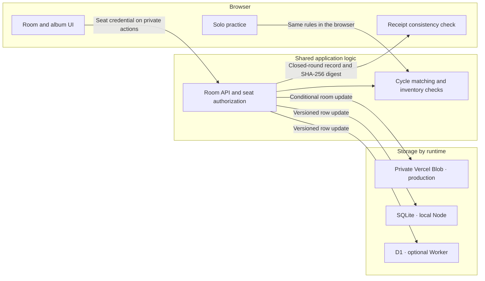
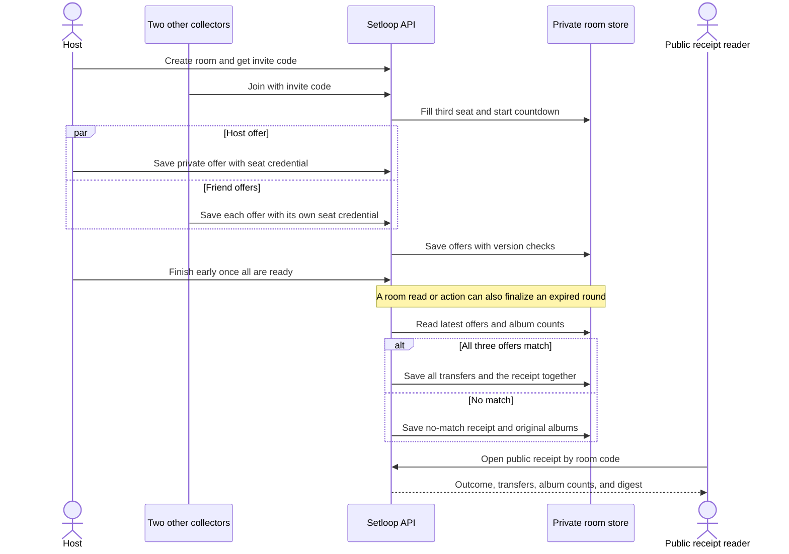

<p align="center">
  <a href="https://setloop.vercel.app/"></a>
</p>

<h1 align="center">Setloop</h1>

<p align="center"><strong>One swap. Three full sets.</strong><br>A private three-person stamp swap you can play in your browser.</p>

<p align="center">
  <a href="https://setloop.vercel.app/"></a>
  <a href="https://setloop.vercel.app/practice?round=choice"></a>
  <a href="https://setloop.vercel.app/docs"></a>
  <a href="LICENSE"></a>
</p>

## Try it

| Start here | What you can verify |
| --- | --- |
| [Practice a Choice round](https://setloop.vercel.app/practice?round=choice) | Pick one of two valid offers for each collector. A round can close without a match even when all three offers were saved. |
| [Play with two friends](https://setloop.vercel.app/) | Create a room, share its code, and save one private offer per player. |
| [Open a verified production receipt](https://setloop.vercel.app/receipt/A4T4S3) | See three completed transfers and the browser's check of the receipt and album totals. |
| [Read the user guide](https://setloop.vercel.app/docs) | Read the steps for hosting, joining, sharing links, and troubleshooting. |

## The problem

A direct swap works only if two people each have what the other needs. Three friends can have all the right pieces and still be stuck. Alice needs Cara's extra Star, Cara needs Ben's extra Moon, and Ben needs Alice's extra Sun.

## What Setloop does

Setloop collects one offer per player and looks for a cycle that satisfies all three. Each person gives one duplicate and receives their missing stamp. If any offer is missing or the offers don't form a complete cycle, everyone keeps their original stamps.

The stamps are digital game pieces. You can play in a browser without signing up, paying, or connecting a wallet.

## How it works

1. **Start a room.** Choose a duration and round type, then share the invite link. The countdown starts when the third player joins.
2. **Save a private offer.** Choose one extra stamp to give and one missing stamp to receive. Other collectors see only whether your offer is ready. You can change it until the round ends.
3. **Finish together.** The timer can run out, or the host can finish early after all three offers are ready. A match moves all three stamps together.
4. **Check the result.** An online round has a public receipt. It records each transfer or shows that no stamps moved.

Classic rounds start with one possible offer per collector. Choice rounds start with two different duplicates per collector. Changing a single offer can break a match even when everyone is ready.

| Collector | Gives | Gets |
| --- | --- | --- |
| Alice | Sun to Ben | Star from Cara |
| Ben | Moon to Cara | Sun from Alice |
| Cara | Star to Alice | Moon from Ben |

### What has been verified

| Path | Status | Evidence |
| --- | --- | --- |
| Hosted multiplayer | Live on Vercel with private Blob storage | A three-player production test verified offer isolation, matching, and public receipt access. [Receipt](https://setloop.vercel.app/receipt/A4T4S3) |
| Solo practice | Live in the browser | Uses the same matching rules and supports both outcomes. [Try it](https://setloop.vercel.app/practice) |
| Local multiplayer | Runs with Node and SQLite | Tests cover concurrent joins and offers, repeated closes, and no-match rounds. [Tests](test/rooms.test.mjs) |
| Solana and MagicBlock | Experimental devnet integration | Program and client are included. A full deployment and three-wallet settlement still need end-to-end verification. [Setup](#experimental-solana-and-magicblock) |

## Architecture



### From offer to public receipt



A production room is one private Blob object. The server reads the latest version and writes only if that version still matches. If another request updates the room first, the server reloads it and tries again. This keeps all album changes and the receipt in one successful update.

The browser recalculates the receipt's SHA-256 digest and checks whether the transfers produce the recorded album counts. These are consistency checks against the record served by Setloop. The hosted receipt names the Setloop server ledger as its source.

## Run locally

Use **Node.js 22.13 or newer**.

```sh
git clone https://github.com/thesithunyein/setloop.git
cd setloop
npm ci
npm start
```

Open [localhost:4173](http://127.0.0.1:4173/). On Windows, you can also run [Start Setloop.cmd](Start%20Setloop.cmd).

| Setting | Default or purpose |
| --- | --- |
| `PORT` | `4173` |
| `SETLOOP_HOST` | `127.0.0.1` |
| `SETLOOP_DB` | Override the SQLite path. The default is `.data/setloop.sqlite`. |
| `SETLOOP_CHAIN_KEYPAIR` | Optional devnet coordinator key path for the experimental adapter |

To try an online round on one device, open **Guide → Technical details → Open three-tab demo**. Open each sample player in a separate tab, save all three offers, then finish from Alice's tab. For a no-match round, let the timer expire with one offer missing.

```sh
npm test
npm run build
```

The tests cover seat-level offer visibility, concurrent joins and writes, repeated closes, expired rounds, stale inventory, and Solana receipt decoding. The Worker build emits `dist/server/` and uses a D1 binding named `DB` with the migration in `drizzle/`.

## Deployment

Production runs at [setloop.vercel.app](https://setloop.vercel.app/) from `main`. The [Vercel config](vercel.json) serves `public/`, packages the browser practice rules, and routes API requests to the [dispatch function](api/dispatch.mjs).

To host your own copy, connect a **private Vercel Blob store** to your project and deploy after the connection is configured. The function supports the store ID with Vercel runtime identity or a project-scoped `BLOB_READ_WRITE_TOKEN`. Keep credentials in the deployment environment.

## Experimental Solana and MagicBlock

The [Anchor program](chain/src/lib.rs) models stamp credits in a room account. It prepares permissions before writing offers into the private rollup, checks the full cycle at settlement, clears offers, and publishes a round summary. The settlement coordinator is a separate trusted role with access to the offers.

The [Node adapter](chain/bridge.mjs) can route local rooms to a deployed devnet program. It signs on behalf of demo seats with test funds. The [receipt decoder](src/solana.mjs) checks the account owner and layout against the configured program ID.

With an Anchor-compatible SBF toolchain, run these commands in `chain/`:

```sh
cargo test --locked
cargo build-sbf -- --locked
npm ci
```

Deploy to **Solana devnet** using a funded devnet-only wallet and a program keypair that matches `declare_id!`. If you use a new program ID, update `chain/Anchor.toml`, `chain/src/lib.rs`, `chain/client.mjs`, and `src/solana.mjs`.

```sh
npm run demo -- /absolute/path/to/devnet-keypair.json
npm run demo -- /absolute/path/to/devnet-keypair.json --no-match
npm run verify -- YOUR_SOLANA_ROUND_ADDRESS
```

A complete devnet check requires three wallets, own-offer access, denied cross-seat reads, a commitment signature, and a base-layer receipt with the expected album counts. The no-match run sends three valid but incompatible offers and checks that every album keeps its original counts. To test from the web app locally, set `SETLOOP_CHAIN_KEYPAIR` before starting Node. Keep keypair files outside the repository. [MagicBlock examples](https://github.com/magicblock-labs/magicblock-examples)

## Project structure

```text
setloop/
├── .gitignore / .vercelignore    Local data, secrets, and upload exclusions
├── api/
│   └── dispatch.mjs             Vercel API entry point
├── chain/
│   ├── Anchor.toml               Solana devnet configuration
│   ├── Cargo.toml / Cargo.lock
│   ├── package.json / package-lock.json
│   ├── bridge.mjs                Node-to-devnet adapter
│   ├── client.mjs                Program and private rollup client
│   ├── demo.mjs                  Devnet smoke test
│   ├── verify.mjs                Devnet receipt CLI
│   └── src/
│       ├── lib.rs                Anchor program and permissions
│       └── matching.rs           Rust matching and inventory rules
├── drizzle/
│   ├── 0000_setloop_rooms.sql    D1 room schema
│   └── meta/_journal.json        D1 migration journal
├── public/
│   ├── index.html                Shared HTML shell
│   ├── app.js                    Landing, room, practice, receipt, and guide UI
│   ├── styles.css                Styles and illustrations
│   ├── setloop-logo.png           Current logo and favicon
│   ├── blitz-evidence.json        Published devnet proof links
│   ├── favicon.svg / lettermark.svg / logo.svg
│   └── google-sans.woff2 / Google-Sans-OFL.txt
├── src/
│   ├── api.mjs                   Room and receipt routes
│   ├── blob-store.mjs            Private Blob and conditional writes
│   ├── build.mjs                 Worker packaging
│   ├── launch.mjs                Windows launch helper
│   ├── room.mjs                  Shared matching rules and private room views
│   ├── server.mjs                Local HTTP and SQLite runtime
│   ├── solana.mjs                Devnet receipt decoder
│   ├── store.mjs                 Versioned SQL storage
│   └── worker.mjs                Optional D1 Worker runtime
├── test/
│   ├── blob-store.test.mjs        Fresh reads and stale-write rejection
│   ├── rooms.test.mjs             Multiplayer, privacy, and settlement
│   └── solana.test.mjs            Receipt account validation
├── package.json / package-lock.json
├── Start Setloop.cmd
├── vercel.json
├── README.md
├── SECURITY.md
├── CONTRIBUTING.md
├── CODE_OF_CONDUCT.md
└── LICENSE
```

## Security and community

The server stores hashes of player credentials and exposes an open offer only to its owner during normal play. Public receipts include player nicknames, album counts, and matching transfers. The hosted game trusts the Setloop server and its private store. Setloop has had functional testing and has yet to undergo an independent security audit.

See the [security policy](SECURITY.md), [contribution guide](CONTRIBUTING.md), and [code of conduct](CODE_OF_CONDUCT.md).

## License

Setloop's original software and documentation are under the [MIT License](LICENSE). Google Sans is bundled under the [SIL Open Font License](public/Google-Sans-OFL.txt). Branding and third-party assets retain their respective rights.
